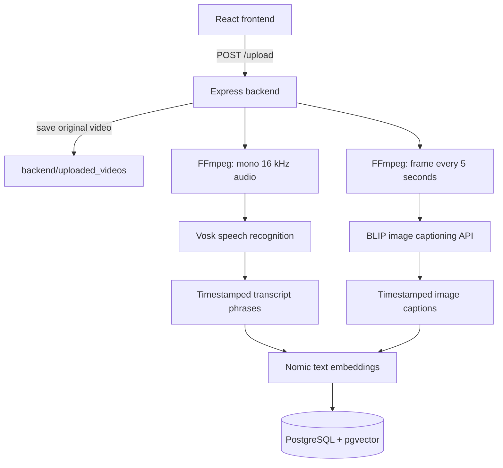
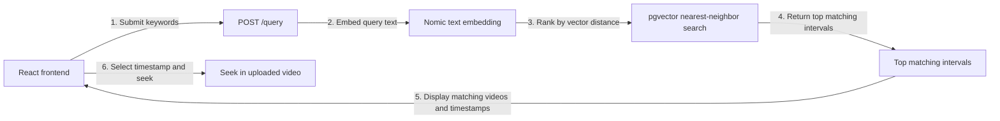
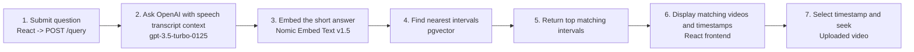

# SceneSifter Architecture

SceneSifter turns uploaded videos into timestamped text descriptions, embeds those descriptions for semantic search, and returns matching moments in the original videos.

## Components

| Component | Responsibility |
| --- | --- |
| `frontend/src/App.js` | Selects and uploads video files, sends search text, displays matching clips and timestamps, and seeks the video player to a selected moment. |
| `backend/src/index.mjs` | Express API and workflow coordinator. Exposes `/upload`, `/query`, and static video files under `/videos`. |
| `backend/src/process_video.mjs` | Uses FFmpeg to convert audio to mono 16 kHz PCM WAV and to extract video frames. |
| `backend/src/speech_to_text.mjs` | Runs Vosk recognition on extracted audio and groups recognized words into timestamped phrases. |
| `backend/src/image_to_text.mjs` | Captions sampled video frames and makes timestamped descriptions. |
| `backend/src/postgres_service.mjs` | Loads the text-embedding model, creates embeddings, writes records, and runs nearest-neighbor searches. |
| `backend/src/chatgpt.mjs` | Uses OpenAI chat completions to turn question-style searches into a short answer based on accumulated speech transcripts. |
| `sql/video_listing.sql` | Enables pgvector and defines the searchable interval table. |

## Upload and Indexing

1. The React app sends a video as multipart form data to `POST http://localhost:5001/upload` with the form field `video`.
2. Multer saves the original video in `backend/uploaded_videos` (resolved from the backend process's working directory). The same directory is served at `/videos` for browser playback.
3. The backend starts two processing paths:
   - **Speech:** FFmpeg extracts mono, 16 kHz PCM audio. Vosk produces word-level recognition results; `speech_to_text.mjs` combines adjacent words into phrases when the gap is less than 0.5 seconds. Each phrase has start/end times and transcript text.
   - **Visual descriptions:** FFmpeg extracts a frame every 5 seconds. Each frame is sent to Hugging Face's `Salesforce/blip-image-captioning-large` inference endpoint. Its generated caption is stored with the frame's timestamp and a 5-second interval.
4. Both paths send interval records to `PostgresService.insert`. Each record includes the video name, start/end seconds, a `source` value (`speech` or `image`), and its text `description`.
5. Before inserting, `postgres_service.mjs` embeds every description and stores the embedding alongside its text and timestamp.

### Models Used

- **Speech recognition:** Vosk, using the model files under `backend/model`. The root README identifies the model as `vosk-model-en-us-0.22-lgraph`; however, `backend/model/README` describes an Appen/Kaldi universal English dynamic-graph model. Verify which model is actually present before relying on that exact model name.
- **Image captioning:** Hugging Face Inference API model `Salesforce/blip-image-captioning-large`, authenticated with `HUGGINGFACE_TOKEN` from `backend/src/application.properties.ini`. `image_to_text.mjs` also defines a local Transformers pipeline helper, but the active video-captioning flow calls the Hugging Face API helper instead.
- **Text embeddings:** `nomic-ai/nomic-embed-text-v1.5`, loaded through `@xenova/transformers` with `pipeline('feature-extraction', ...)` in `postgres_service.mjs`. The configured pipeline is non-quantized. Text is mean-pooled, layer-normalized, truncated to 512 dimensions, L2-normalized, and converted to a JavaScript array. The same steps are used for stored descriptions and search text. This is separate from the chat LLM; embeddings are generated by the Transformers pipeline, not the OpenAI chat API.
- **Question answering:** OpenAI chat completion model `gpt-3.5-turbo-0125`, configured with `CHATGPT_API_KEY`. It is only used for searches whose final character is `?`.

## Search and Playback

### Keyword Search (No `?`)

### Question Search (Ends With `?`)

**Transcript context:** The backend does not rebuild this context from PostgreSQL when a question arrives. During each upload, recognized speech is concatenated and appended to `ChatService`'s in-memory context; a later question sends that accumulated text to OpenAI. It is not persisted as a single context and is lost when the backend restarts. It currently combines speech from all uploaded videos, not image captions.

1. The frontend sends `POST /query` with JSON `{ "keywords": "..." }`.
2. If the search text ends with `?`, `ChatService` sends the question and its accumulated transcript context to OpenAI and uses the returned short answer as the search text. Otherwise, the original keywords are used directly.
3. `PostgresService.search` embeds that text with Nomic and orders rows by pgvector's `<=>` distance operator. The query returns up to five intervals and calculates `similarity` as `1 - distance`.
4. The API groups matching intervals by video name and returns video URLs, timestamps, and descriptions. The frontend displays the videos and matching moments; selecting a timestamp seeks the corresponding player.

The visual captions are indexed and searchable, but are not included in the context sent to ChatGPT.

## Data Storage

The `video_listing` table created by `sql/video_listing.sql` contains:

| Column | Meaning |
| --- | --- |
| `video_name` | Original uploaded filename. |
| `start_time`, `end_time` | Interval boundaries in seconds. |
| `source` | `speech` or `image`. |
| `description` | Transcript phrase or image caption. |
| `description_embedding` | 512-dimensional pgvector embedding of the description. |

PostgreSQL connection settings are read from `backend/src/application.properties.ini` (`DATABASE_HOST`, `DATABASE_PORT`, `DATABASE_NAME`, `DATABASE_USER`, and `DATABASE_PASSWORD`). The schema uses the pgvector extension.

> **Caution:** `sql/video_listing.sql` contains `DROP TABLE IF EXISTS video_listing`. Running this setup script against an existing database deletes the current table and its indexed records before recreating it.

## Configuration and Run Locations

- Backend dependencies and start command: `backend/package.json` (`npm install`, then `npm start` from `backend`). The API listens on port `5001`.
- Frontend API URLs are hard-coded to `http://localhost:5001`; the React development server is started from `frontend`.
- Set `CHATGPT_API_KEY` and `HUGGINGFACE_TOKEN` in `backend/src/application.properties.ini` to enable question answering and image captioning. Keep credentials private and out of version control.
- The Vosk model directory is resolved as `path.join(process.cwd(), "model")`; start the backend from `backend` so this points to `backend/model`.

## Implementation Notes

- Upload processing is launched in parallel for speech and frames. The current upload handler does not await the database insert callbacks before its processing promises resolve, so an upload-success response may arrive before all database writes have completed.
- The question-vs-keywords distinction is based only on whether the last character is `?`.
- `sql/video_listing.sql` recreates the table on every run; treat it as a destructive bootstrap script, not a routine migration.
